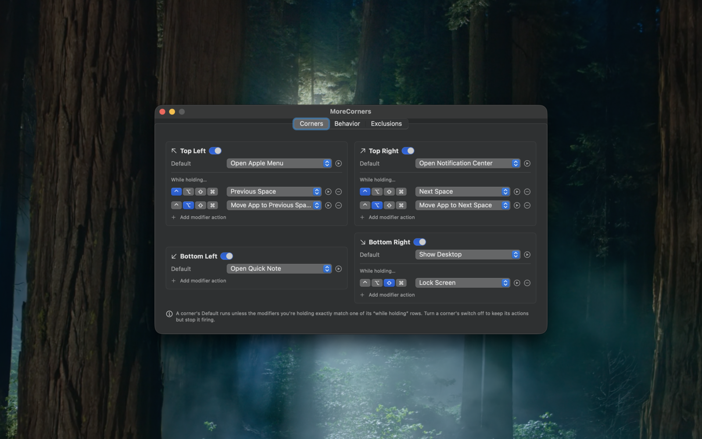
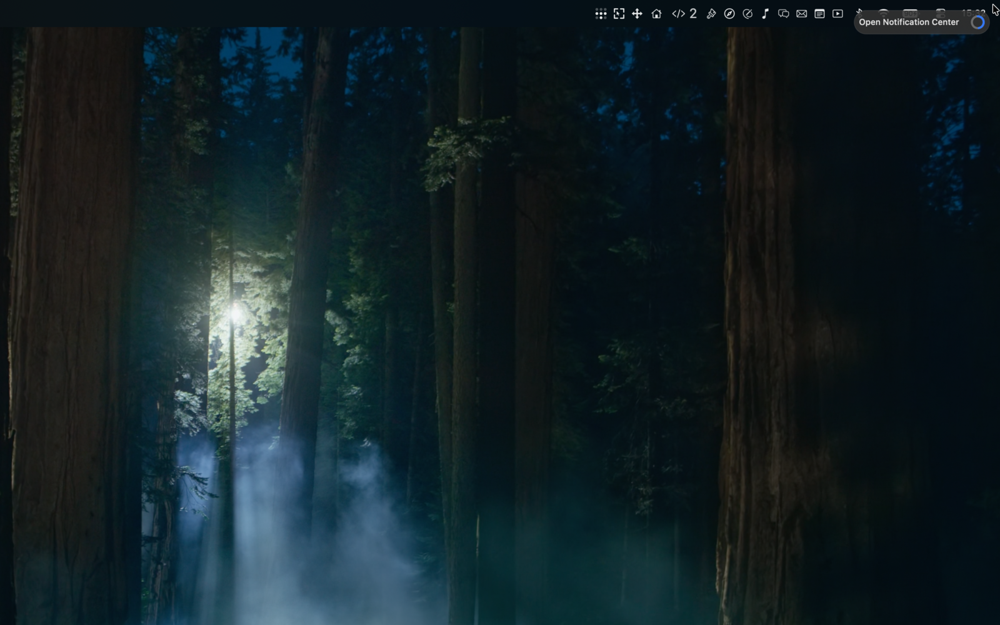
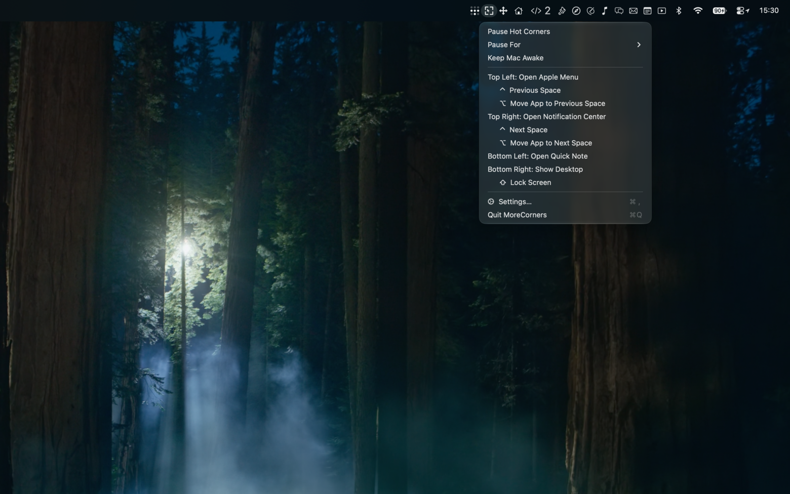

# MoreCorners

**Hot corners for macOS, without the limits.**


macOS gives you four hot corners, four actions, and one modifier each.
MoreCorners gives every corner a default action *plus* any number of
modifier-specific overrides, drawn from a catalog of 46 actions — including
things macOS doesn't offer anywhere, like moving the focused window to the
next Space, tiling it to half the screen, or muting your microphone.

It lives in the menu bar, needs no permissions to detect corners, and stays
out of the way when you're not using it.



## Features

- **46 actions** across Spaces, window tiling, media, capture, power, and
  custom (shell, AppleScript, Shortcuts, keystrokes, apps, URLs).
- **Modifier overrides** — one corner can do five different things depending
  on what you're holding. Combos match exactly.
- **Two trigger styles** — dwell with a configurable delay, or *push into the
  corner* for instant, macOS-style firing.
- **Multi-display aware** — only the exposed corners of the combined desktop
  fire, so crossing between monitors is safe.
- **Knows when to stay quiet** — pause on demand or on a timer, suppress in
  full-screen apps, exclude specific apps, never fire at the lock screen.
- **Feedback you choose** — corner flash, sound, haptic tap, and a dwell
  progress ring that names the action about to fire.
- **Light footprint** — no event taps, no input monitoring. A single adaptive
  poll that idles when the pointer is nowhere near a corner.

## Install

Download the latest `MoreCorners-<version>.dmg` from
[Releases](../../releases), open it, and drag **MoreCorners** to Applications.
Releases are Developer ID signed and notarized, so it opens normally.

Or build it yourself — needs Xcode (SwiftPM uses its toolchain for the
SwiftUI macros):

```sh
git clone <this repo> && cd <repo>
./build.sh
open build/MoreCorners.app
```

## Usage

On first launch, Settings opens with a working default layout. Change
everything in the **Corners** tab — each row has a ▶ button to try its action
immediately.





Each corner has a **Default** action plus any number of **"While holding…"**
rows binding an exact modifier combination to its own action:

- Hit the corner → the Default runs.
- Hit it holding ⌘ (and a ⌘ row exists) → that action runs instead.
- Combos match exactly: ⌘⇧ does not trigger the ⌘ row.
- Leave Default as "None" to make a corner that only fires with modifiers held.
- Hit a corner again to close what it opened: Mission Control, Application
  Windows, Show Desktop, Launchpad / Apps and Notification Center all toggle,
  just like the built-in hot corners.

The menu bar icon gives quick access to every configured action, pause
controls, Keep Awake, and Settings. You can hide it entirely — to get Settings
back, just launch MoreCorners again (`open -a MoreCorners`); the running app
reopens the window instead of starting a second copy.

### Actions

| Group | Actions |
|---|---|
| **Windows & Desktop** | Mission Control · Application Windows · Show Desktop · Launchpad · Control Center · Notification Center · Apple Menu · Quick Note · Next/Previous Space · Move App to Next/Previous Space · Move Window to Left/Right Half · Maximize Window · Center Window · Hide Frontmost App · Hide Others · Quit Frontmost App |
| **Display & Power** | Lock Screen · Screen Saver · Display Sleep · System Sleep · Toggle Keep Awake · Brightness Up/Down · Log Out |
| **Sound & Media** | Toggle Mute · Toggle Microphone Mute · Volume Up/Down · Play/Pause · Next/Previous Track |
| **Capture** | Screenshot Area → Clipboard · Screenshot Screen → Desktop |
| **System** | Toggle Dark Mode · Toggle Dock Auto-Hide · Empty Trash |
| **Open & Run** | Launch App · Open URL · Open File/Folder · Run Shell Command · Run AppleScript · Run Shortcuts Shortcut · Press Keyboard Shortcut |

Parameterized actions get a text field. `Open URL` accepts a bare host like
`example.com`. `Press Keyboard Shortcut` takes specs like `cmd+shift+4` or
`ctrl+left`. `Run Shortcuts Shortcut` runs any Shortcuts-app shortcut by name
— handy for things with no public API, like Focus modes.

### Settings

**Triggering** — dwell delay (0–1 s) and corner size (2–24 px) with a live
preview of the zones, or instant push-into-corner activation; per-corner
on/off; all displays or just the main one.

**Staying out of the way** — indefinite or timed pause that survives
relaunches; auto-pause in full-screen apps; per-app exclusions by bundle ID;
never fires during a drag, at the lock screen, or during the screensaver.

**Safety** — optional confirmation before Quit App, Empty Trash and Log Out;
warnings when a macOS system hot corner overlaps one of yours; a live
Accessibility permission indicator.

**Housekeeping** — launch at login, hide the menu bar icon, JSON
export/import, reset to defaults.

## Permissions

Corner detection itself needs **no permissions** — it polls the mouse
position; there's no event tap. Individual actions ask for standard one-time
grants as you use them:

| Permission | Needed by |
|---|---|
| Accessibility | Media keys, brightness, keystrokes, menu-bar panels, Space switching, window moves and tiling |
| Automation | Toggle Dark Mode, Empty Trash, Log Out |
| Screen Recording | Screenshot actions, and **Move App to Next/Previous Space** |

Move App to Next/Previous Space holds the window with a real window-server
drag, and macOS gates one process driving another app's windows behind Screen
Recording — nothing is ever recorded. Without it the move beeps and logs a
hint. Quick Note and Notification Center synthesize the built-in globe
shortcuts (fn+Q / fn+N), so those must stay enabled in System Settings →
Keyboard.

## Development

```sh
swift build                 # build the library and executable
./build.sh                  # assemble build/MoreCorners.app
./build.sh --dmg            # …and package build/MoreCorners.dmg
./build.sh --sign           # Developer ID sign, notarize and staple
./build.sh --publish v1.2   # tag, push and cut a GitHub release
open Package.swift          # full edit/run/test in Xcode — no project file
```

Flags combine. `build.sh` signs local builds with your Apple Development
certificate when one is in the keychain (override with `CODESIGN_IDENTITY`),
because TCC grants are keyed to team + bundle ID — so **permissions survive
rebuilds**. Without a certificate it falls back to ad-hoc signing and
permissions reset on every build.

All logic lives in a `MoreCornersCore` library so it can be unit tested; the
executable is a three-line `main.swift`.

```
Sources/MoreCorners/main.swift      # entry point
Sources/MoreCornersCore/            # all app logic
Tests/MoreCornersCoreTests/         # XCTest suite
```

### Tests

```sh
# XCTest ships with Xcode, not the Command Line Tools:
DEVELOPER_DIR=/Applications/Xcode.app/Contents/Developer swift test
```

Unit tests cover the pure logic — action resolution, modifier matching, corner
geometry, the dwell state machine, tiling math, settings migration, and the
key-spec parsers. An end-to-end harness (`ActionIntegrationTests`, opt-in via
`MORECORNERS_E2E=1`) fires every action on every display and asserts what
public APIs can observe; it's skipped by default because it drives real system
UI.

## How it works

A few techniques are unusual enough to be worth noting:

- **Mission Control, Application Windows and Show Desktop** go through
  `CoreDockSendNotification` — the notification the Dock itself listens on. It
  survives macOS releases where the Mission Control binary moves and
  synthesized ⌃-arrow shortcuts break, and needs no Accessibility grant.
- **Space switching** posts synthetic trackpad dock-swipe gestures rather than
  keyboard shortcuts, so it works regardless of your Mission Control key
  bindings and acts on the display under the pointer.
- **Move App to Next/Previous Space** holds the focused window with a
  server-side drag (`SLSDragWindowRelativeToMouse`) and fires your real "Move a
  space" binding, read live from `com.apple.symbolichotkeys`. The window is
  named by its window-server ID, so nothing on it has to be clickable — a
  toolbar'd title bar or an off-screen window moves as easily as any other.
- **Adaptive polling** runs at 50 ms only when the pointer is within 300 pt of
  an exposed corner, relaxes to 120 ms otherwise, stops entirely while paused,
  and drops to a 2 s heartbeat at the lock screen.

These rely on private SPI, which is why MoreCorners ships notarized outside
the Mac App Store. Fuller notes live in the source comments.

## Uninstall

Quit the app, delete `MoreCorners.app`, and run
`defaults delete dev.nwf.MoreCorners`.
